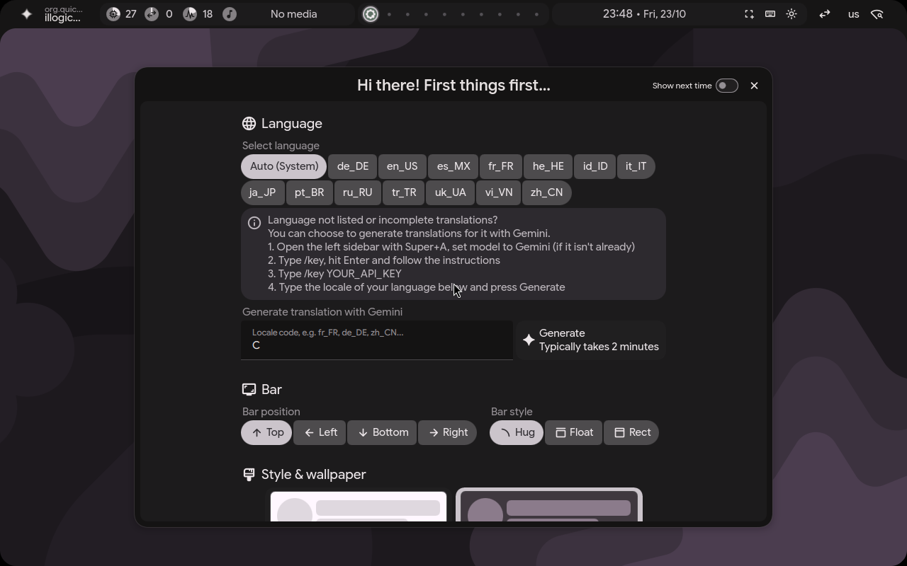
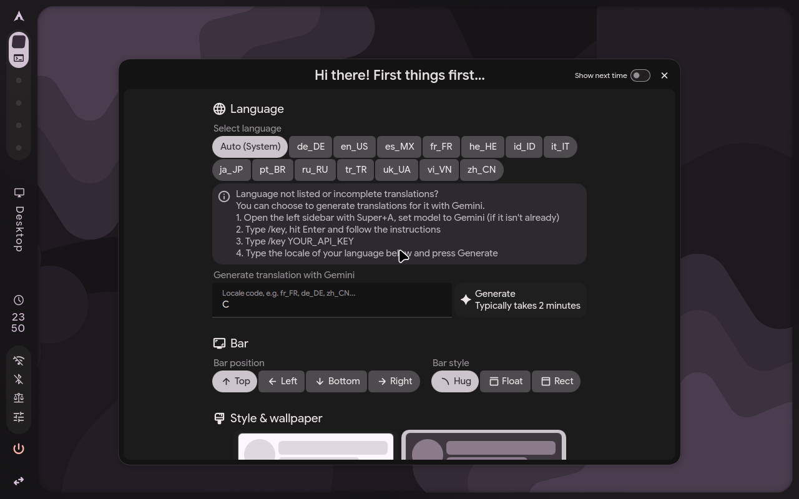
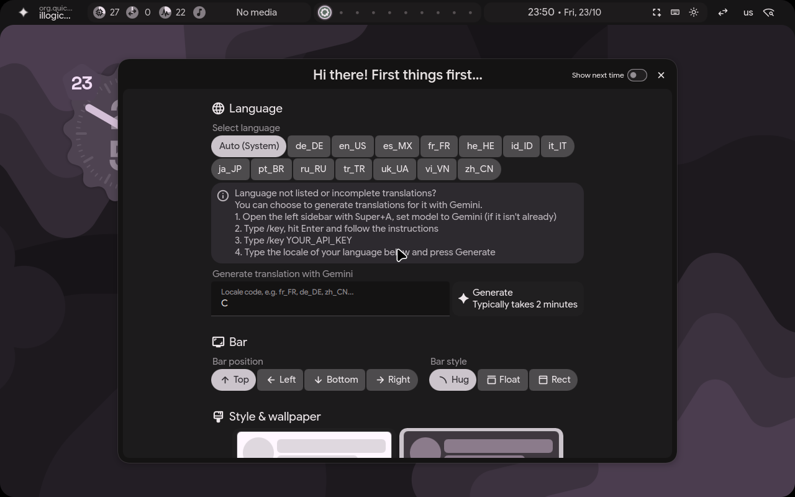

# Hyprland Hybrid Rice

> **Ambiente Wayland híbrido moderno, fluido e esteticamente refinado, integrando o poder do [end-4/illogical-impulse](https://github.com/end-4/dots-hyprland) com a sofisticação do [Caelestia Shell](https://github.com/caelestia-dots/shell).**

[](https://archlinux.org)
[](https://hyprland.org)
[](https://quickshell.outfoxxed.me)
[](./LICENSE)
[](https://github.com/Altaeir-13/dots-hyprland/releases/tag/v0.1.0-beta)

---

## Visão Geral

> [!NOTE]
> **Versão Oficial:** Esta é a versão **`v0.1.0-beta`** do Hyprland Hybrid Rice na branch `main`, integrando os frontends end-4 (illogical-impulse) e Caelestia Shell com testes de reprodução automatizados e instalador multiperfil para Arch Linux.

O **Hyprland Hybrid Rice** une o melhor de dois ecossistemas visuais líderes para Hyprland em um ambiente único e coeso:
- **end-4 (illogical-impulse):** Rica central de controle (`StatusCenter`), widgets funcionais, extração dinâmica de cores Material You e ampla compatibilidade.
- **Caelestia Shell:** Design escultural em Material 3, animações baseadas em física vetorial, shaders fluidos e suporte avançado a papéis de parede animados.

A alternância entre as duas interfaces ocorre em **tempo de execução com um único clique ou atalho**, preservando o estado do compositor, a paleta de cores ativas e os atalhos de hardware.

**Release:** [`v0.1.0-beta`](https://github.com/Altaeir-13/dots-hyprland/releases/tag/v0.1.0-beta) · **Repositório:** <https://github.com/Altaeir-13/dots-hyprland> · **Licença:** [GPL-3.0](./LICENSE)

---

## Capturas de Tela

### 1. Interface end-4 (illogical-impulse)

*Barra dinâmica com botão dedicado de troca de frontend, central de notificações e StatusCenter integrado.*

### 2. Interface Caelestia Shell

*Widgets esculturais, dock flutuante, shaders de blobs e sincronização contínua com a paleta Material You.*

### 3. Alternância Reversa e Estabilidade

*Transição suave e restauração instantânea do estado operacional sem perda de janelas ativas.*

---

## Características Principais

- 🔄 **Dual Frontend em Tempo Real:** Alterne dinamicamente entre `end-4` e `Caelestia` via botão na barra ou pelo comando `ui-switch.sh`.
- 🛡️ **Mecanismo de Rollback da Interface:** Se o frontend secundário apresentar qualquer falha de inicialização ou crash de dependência, o sistema reverte automaticamente para a interface ativa anterior.
- 🎨 **Ponte de Cores Material You:** A paleta de 49 cores gerada pelo `matugen` a partir do seu wallpaper no end-4 é automaticamente traduzida e sincronizada para o `scheme.json` do Caelestia.
- 🎬 **Suporte a Wallpapers em Vídeo e GIF:** Integração automática com `mpvpaper` acelerado por hardware para arquivos `.mp4`, `.webm` e `.gif`.
- 🔒 **Dispatcher Inteligente de Bloqueio (`rice-lock`):** Gerencia a tela de bloqueio respeitando preferências locais (`hyprlock` nativo ou lockers integrados do Quickshell).
- ⌨️ **Layout de Teclado `us` / `br`:** Alternância rápida entre teclados com atalhos de brilho e áudio unificados.
- 📦 **Perfis Declarativos de Instalação:** Instale exatamente o que precisa através dos perfis `minimal`, `hybrid` ou `complete`.

---

## Requisitos do Sistema

- **Arquitetura:** `x86_64`.
- **GPU:** Suporte a OpenGL / Vulkan (Intel, AMD ou NVIDIA com modesetting habilitado).
- **Memória RAM:** Mínimo de 4 GiB (recomendado 8 GiB ou mais para compilação rápida do QuickShell).
- **Armazenamento Livre:** Mínimo de 15 GiB de espaço livre no disco raiz (`/`).
- **Acesso à Internet:** Necessário durante a instalação para download e compilação de pacotes.

---

## Distribuições Suportadas

| Sistema | Status | Observação |
| :--- | :--- | :--- |
| **Arch Linux** (`x86_64`) | ✅ Oficialmente suportado | Validado em CI (testes sandbox) e em VM Arch Linux. |
| Derivadas do Arch (EndeavourOS, CachyOS, Manjaro, Garuda…) | ⚠️ Usam o caminho do Arch, **não testadas** por este projeto | Detectadas pelo instalador como `arch` (por `ID` ou `ID_LIKE=arch`; neste último caso com o aviso upstream de correspondência por semelhança). |
| Fedora, Gentoo, Nix (`--via-nix`), Debian/Ubuntu/openSUSE e outras | ❌ Sem suporte oficial | Código herdado do upstream mantido; **exige confirmação explícita** (ver abaixo). |

- **Arch Linux:** **Oficialmente suportado e homologado.** O instalador resolve automaticamente metapacotes PKGBUILD, dependências oficiais e pacotes do AUR via `yay-bin`.
- **Outras Distribuições (sem suporte oficial):** o código herdado do upstream `end-4/dots-hyprland` para **Fedora** (`sdata/dist-fedora`), **Gentoo** (`sdata/dist-gentoo`) e **Nix / `--via-nix`** (`sdata/dist-nix`, também usado como fallback para Debian, openSUSE e distribuições não reconhecidas) **continua presente no repositório e não foi removido**, em respeito ao projeto original. Porém, **essas implementações não possuem suporte oficial no Hybrid Rice e não foram validadas com a integração Caelestia** (plugin `Caelestia`, `libcava`, `qt6-m3shapes`, `ui-switch.sh`, pontes de cores). Elas só instalam as dependências do end-4; o frontend Caelestia pode ficar incompleto ou não funcionar.
  - **O que o instalador faz fora do Arch:** exibe um aviso vermelho de distribuição não suportada **antes de qualquer alteração no sistema**. Em `./setup install` e `./setup install-deps`, a execução só continua após confirmação interativa explícita (`[y/N]`, padrão **Não**). Em modo não interativo (`-f` / `--force`), o instalador **aborta sem alterar nada**, a menos que você defina `HYBRID_ALLOW_UNSUPPORTED_DISTRO=true`.
  - `--dry-run` apenas exibe o aviso, sem abortar. `./setup install-files` (somente cópia de configurações) exibe o aviso sem bloquear.
  - Para prosseguir por sua conta e risco (não recomendado): `HYBRID_ALLOW_UNSUPPORTED_DISTRO=true ./setup install --profile minimal -f`.

---

## Perfis de Instalação

| Perfil | Descrição | Espaço em Disco |
| :--- | :--- | :--- |
| **`minimal`** | Hyprland + end-4 core essencial. Ideal para hardware modesto ou usuários focados em desempenho absoluto. | ~3.8 GiB |
| **`hybrid`** *(Padrão)* | end-4 + Caelestia Hybrid + Plugin C++ nativo + pontes de cores e wallpapers animados. | ~7.5 GiB |
| **`complete`** | Híbrido completo + suite expandida de ferramentas de terminal e mídia (`fish`, `kitty`, `foot`, `starship`, `easyeffects`). | ~7.6 GiB |

---

## Procedimento de Instalação

### 1. Clonar o Repositório
Clone o repositório com todos os submódulos necessários a partir da branch principal (`main`):

```bash
git clone --recursive https://github.com/Altaeir-13/dots-hyprland.git ~/dots-hyprland
cd ~/dots-hyprland
```

Para instalar exatamente a versão publicada (recomendado para reproduzibilidade), use a tag da release:
```bash
git clone --recursive --branch v0.1.0-beta https://github.com/Altaeir-13/dots-hyprland.git ~/dots-hyprland
cd ~/dots-hyprland
```
> O `git` precisa estar instalado antes do clone (`sudo pacman -S --needed git`). O instalador instala os demais pré-requisitos (como `rsync`) no Arch Linux.

### 2. Simulação Não-Destrutiva (Recomendado)
Antes de efetuar alterações, você pode testar a instalação sem modificar arquivos:
```bash
./setup install --profile hybrid --dry-run
```

### 3. Instalar o Rice
Para instalar com o perfil híbrido padrão:
```bash
./setup install --profile hybrid
```

Para instalação automatizada/não-interativa:
```bash
./setup install --profile hybrid -f --log-file ~/install-hybrid.log
```

Para o perfil completo com todos os terminais e ferramentas extras:
```bash
./setup install --profile complete -f
```

---

## Dependências do AUR e Considerações de Segurança

O perfil híbrido compila e instala dependências oficiais e componentes do Arch User Repository (AUR), incluindo:
- `qt6-m3shapes-git`: Primitivas vetoriais de animação do Caelestia.
- `libcava`: Biblioteca de visualização de espectro de áudio.
- `ttf-material-symbols-variable-git`, `ttf-rubik-vf`: Tipografia da interface.
- `breeze-plus`, `darkly-bin`: Estilos de janelas e temas Qt.

### Modos de Instalação e Confirmação de Pacotes:
- **Modo Interativo Padrão (`./setup install`):**
  O instalador opera com confirmação ativada (`$ask=true`). O `yay` e o `pacman` solicitam confirmação ao usuário, permitindo revisar a lista de dependências, inspecionar diffs e verificar PKGBUILDs de terceiros antes de autorizar a compilação e a instalação no sistema.
- **Modo Automatizado (`./setup install -f` ou `--force`):**
  Indicado exclusivamente para testes, integração contínua (CI) e instalações não-assistidas em ambientes descartáveis ou VMs limpas. Neste modo, `--noconfirm` é propagado para `pacman` e `yay` aceitando seleções automáticas.

> [!WARNING]
> O uso de `-f` / `--force` suprime confirmações de instalação, mas **nunca remove pacotes do usuário nem autoriza a exclusão silenciosa** de dados pessoais ou diretórios desconhecidos. A remoção de pacotes legados/obsoletos só ocorre sob autorização explícita com a variável `ALLOW_REMOVE_DEPRECATED=true` (ou via confirmação `[y/N]` no modo interativo).

### Proteção de Submódulos e Arquivos Pessoais
Caso o caminho de um submódulo Git (como `shapes`) já contenha arquivos preexistentes do usuário ou alterações não gerenciadas:
- O instalador **aborta imediatamente**, sem sobrescrever ou apagar qualquer arquivo.
- Se desejar que o instalador arquive automaticamente o diretório conflitante com um identificador único fora do repositório (`~/.local/state/dots-hyprland/submodule-backups/`), execute com a opção explícita:
  ```bash
  ./setup install --archive-submodule-conflicts
  ```

---

## Operação do Ambiente Híbrido

### Alternando entre Interfaces
1. **Via Barra Gráfica:** Clique no ícone de alternância localizado na barra superior do desktop.
2. **Via Terminal ou Atalho (`Super + Tab`):**
   ```bash
   # Execução direta pelo comando no PATH (~/.local/bin/ui-switch.sh):
   ui-switch.sh caelestia   # Ativar Caelestia Shell
   ui-switch.sh end4        # Ativar end-4 (illogical-impulse)

   # Ou pelo caminho de instalação do Quickshell:
   ~/.config/quickshell/ui-switch.sh caelestia
   ```

### Bloqueio de Tela
Acione a tela de bloqueio com `SUPER + L` ou via terminal:
```bash
rice-lock
```
O dispatcher detecta qual interface está em execução e aciona a rotina correta.

### Atualizando as Configurações
Para atualizar o rice preservando customizações locais:
```bash
cd ~/dots-hyprland
git pull
./setup install-files
```

---

## Backups e Recuperação Manual

### Backups Automáticos
- **Backup de Conflitos Globais:** Antes de sobrescrever qualquer arquivo ou diretório conflitante, o instalador gera automaticamente um snapshot completo em:
  ```
  ~/ii-original-dots-backup/
  ```
  *(Em reexecuções sucessivas ou se a pasta já existir, são criados diretórios timestampados com formato `~/ii-original-dots-backup-AAAAMMDD-HHMMSS/`).*
- **Proteção em Sincronizações com `rsync --delete`:** Diretórios gerenciados (`quickshell/ii`, `quickshell/caelestia-hybrid` e `hypr/hyprland`) utilizam sincronização com deleção para manter paridade exata com o repositório. Arquivos não gerenciados ou adicionados manualmente pelo usuário dentro dessas pastas são **automaticamente movidos para o diretório de backup** (`~/ii-original-dots-backup-*/sync-deleted/<componente>/`) antes da sincronização, nunca sendo excluídos silenciosamente.
- **Customizações Permanentes:** Para configurações próprias que **nunca** devem ser modificadas ou sincronizadas pelo instalador, utilize a pasta dedicada:
  ```
  ~/.config/hypr/custom/
  ```
  *(Arquivos como `monitors.lua`, `workspaces.lua` e `general.lua` são sincronizados com `--ignore-existing` e permanecem 100% sob controle do usuário).*

### Recuperação Manual
Caso uma transição trave ou uma customização impeça o carregamento da interface gráfica:
1. Abra um terminal virtual via `Ctrl + Alt + F3` (ou conecte-se via SSH).
2. Force a restauração para o frontend base end-4:
   ```bash
   killall -9 quickshell qs mpvpaper 2>/dev/null
   echo "end4" > ~/.local/state/quickshell/ui-switch/current
   qs -c ii &
   ```
3. Para restaurar um arquivo específico do backup gerado:
   ```bash
   cp -r ~/ii-original-dots-backup/.config/<arquivo-desejado> ~/.config/
   ```
4. Para consultar o log da última instalação e verificar passos executados:
   ```bash
   cat ~/.local/state/illogical-impulse/logs/setup-*.log | tail -n 50
   ```

---

## Limitações Conhecidas

> [!IMPORTANT]
> - **Escopo do Rollback:** O mecanismo de rollback automático embutido em `ui-switch.sh` aplica-se **estritamente à alternância em tempo real da interface visual (frontends)**. Ele **não constitui um rollback transacional do sistema operacional nem do gerenciador de pacotes pacman**.
> - **Ambientes Virtualizados (VMs):** O daemon `ydotool` requer acesso a `/dev/uinput`. Em algumas VMs, pode ser necessário carregar o módulo manualmente: `sudo modprobe uinput`.
> - **Placas NVIDIA:** Recomenda-se adicionar o parâmetro de kernel `nvidia-drm.modeset=1` e desabilitar cursores de hardware (`export WLR_NO_HARDWARE_CURSORS=1`) no Hyprland caso observe travamentos visuais.
> - **Recursos Pessoais:** Arquivos pessoais (como wallpapers locais em `~/Pictures`, chaves SSH ou tokens de API) **não são distribuídos** no repositório por razões de privacidade e licença.

---

## Desenvolvimento e CI

- **Testes locais (sandbox, sem tocar no sistema):** `bash tests/run-tests.sh`.
- **CI (`.github/workflows/ci.yml`):** executa `Static Syntax & Portability Checks` e `Automated Regression Test Suite (Sandboxed)` em cada Pull Request e push para `main`.
- **Workflows herdados do upstream** (moderação automática, notificações do end-4) foram **desativados** e estão preservados em [`.github/workflows-disabled/`](./.github/workflows-disabled/README.md), com a justificativa de cada decisão.
- O README original do upstream foi preservado em [`docs/upstream/END4-README.md`](./docs/upstream/END4-README.md).

---

## Atribuições e Licenciamento

Este projeto respeita e preserva integralmente os direitos dos autores originais:

- **Base do Sistema e Frontend `ii` / `waffle`:**  
  Desenvolvido por **[end-4](https://github.com/end-4)** sob a licença **GNU GPLv3**.  
  Consulte [`LICENSE`](./LICENSE) para o texto completo da licença.
- **Frontend Caelestia Hybrid e Plugin C++:**  
  Desenvolvido pela equipe **[Caelestia Dots](https://github.com/caelestia-dots/shell)** sob a licença **GNU GPLv3**.  
  Código do plugin compilado e integrado a partir da revisão upstream fixada `454f46da`.
- **Camada de Integração Híbrida (`ui-switch.sh`, `rice-lock`, bridges de cores e vídeo):**  
  Licenciada sob a licença **GNU GPLv3**.
- **Tipografia e Fontes:**
  - *Google Sans Flex*: Open Font License (OFL).
  - *JetBrains Mono Nerd Font*: SIL OFL / Apache-2.0.
  - *Material Symbols Variable*: Apache-2.0.
  - *Readex Pro / Rubik VF*: SIL OFL.
- **Ícones e Temas:**
  - *Fluent System Icons*: Microsoft (Licença MIT).
  - *Adwaita GTK Theme*: GNU LGPL-2.1.
  - *Bibata Modern Classic*: GNU GPLv3.
