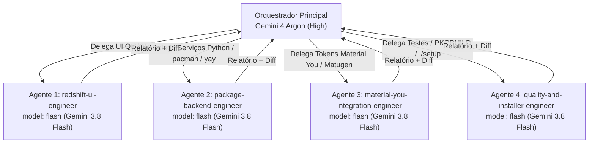

# Arquitetura de Orquestração Multiagente — Redshift OS

Este documento descreve a organização multiagente persistente do repositório **Redshift OS** (`dots-hyprland`), projetada para o **Google Antigravity 2.0** (`v2.26.0+`).

---

## 1. Visão Geral da Arquitetura

A engenharia do Redshift OS divide responsabilidades entre um **modelo orquestrador de alto raciocínio** e uma **equipe de subagentes especializados de execução rápida**:



### Divisão de Papéis

| Camada | Modelo | Responsabilidades Exclusivas |
| :--- | :--- | :--- |
| **Orquestrador Principal** | **Gemini 4 Argon (High)** (`gemini-4-argon-high`) | Análise arquitetural, planejamento de marcos, grafo de dependências, definição de interfaces/contratos, decisões críticas de segurança, revisão de diffs, integração de branches/worktrees e aprovação final. |
| **Subagentes Especialistas** | **Gemini 3.8 Flash** (`model: flash` → `gemini-3.8-flash-tiered`) | Pesquisa de código, leitura de arquivos, implementação de módulos isolados, criação e execução de testes em sandbox/mocks, empacotamento e documentação. |

---

## 2. Seleção e Verificação de Modelos no Antigravity 2.0

### Como Selecionar o Orquestrador Principal
1. No painel lateral esquerdo (**Settings** → **Model Selection**) ou no seletor de modelo do chat do Antigravity 2.0, selecione **`Gemini 4 Argon (High)`** (identificador interno: `gemini-4-argon-high`).
2. O arquivo de regras [`.agents/rules/multiagent-orchestration.md`](file:///home/greyrat/Projetos/dots-hyprland/.agents/rules/multiagent-orchestration.md) é carregado automaticamente em todas as sessões iniciadas neste repositório.

### Como os Subagentes Selecionam o Gemini 3.8 Flash
- O validador de agentes do Antigravity (`v2.26.0-1`) aceita estritamente os identificadores de tier `'inherit'`, `'flash_lite'`, `'flash'` ou `'pro'` tanto no YAML frontmatter (`model: flash`) quanto na ferramenta `invoke_subagent` (`Model: "flash"`).
- No catálogo ativo do Language Server (`GetAvailableModels` → `tieredModelIds`), o identificador `flash` resolve diretamente para **`gemini-3.8-flash-tiered`** (`MODEL_PLACEHOLDER_M322`, janela de 1.048.576 tokens de entrada e 65.536 tokens de saída).
- **Nota técnica**: Passar a string literal `gemini-3.8-flash` no campo `model` do frontmatter ou em `invoke_subagent` é rejeitado pelo parser da plataforma (`unsupported model: must be one of 'inherit', 'flash', 'pro', 'flash_lite'`). Portanto, `model: flash` é o mecanismo oficial e verificável para acionar o Gemini 3.8 Flash.

### Como Verificar a Descoberta dos Agentes
Para confirmar que o Language Server do Antigravity descobriu todos os agentes do repositório:

```bash
: "${ANTIGRAVITY_LS_ADDRESS:=localhost:5387}"
curl -sS -X POST \
  "http://${ANTIGRAVITY_LS_ADDRESS}/exa.language_server_pb.LanguageServerService/GetCustomizationStates" \
  -H "Content-Type: application/json" \
  -H "x-codeium-csrf-token: ${ANTIGRAVITY_CSRF_TOKEN}" \
  -d '{"workspaceUris":["file:///home/greyrat/Projetos/dots-hyprland"]}' | jq '.states[] | select(.type == "REFRESH_CUSTOMIZATION_TYPE_AGENT")'
```

---

## 3. Catálogo de Subagentes (`.agents/agents/`)

| Identificador (`TypeName`) | Arquivo | Escopo Técnico | Restrições Principais |
| :--- | :--- | :--- | :--- |
| `redshift-ui-engineer` | [`.agents/agents/redshift-ui-engineer.md`](file:///home/greyrat/Projetos/dots-hyprland/.agents/agents/redshift-ui-engineer.md) | Interfaces Qt6/QML, Quickshell, páginas, cards, navegação, layouts responsivos, animações e estados visuais. | Não modificar backend de pacotes sem autorização do orquestrador. |
| `package-backend-engineer` | [`.agents/agents/package-backend-engineer.md`](file:///home/greyrat/Projetos/dots-hyprland/.agents/agents/package-backend-engineer.md) | Serviços Python assíncronos, integração com `pacman`, `yay`, AppStream e AUR RPC, logs, locks e contratos UI-Backend. | Não criar gerenciador independente; nunca rodar `yay`/`makepkg` como root; sem operações destrutivas reais. |
| `material-you-integration-engineer` | [`.agents/agents/material-you-integration-engineer.md`](file:///home/greyrat/Projetos/dots-hyprland/.agents/agents/material-you-integration-engineer.md) | Tokens Material You, integração com Matugen, sincronização claro/escuro e monitoramento de wallpaper em end-4 e Caelestia. | Não alterar geradores globais (`switchwall.sh`) sem necessidade demonstrada e autorização. |
| `quality-and-installer-engineer` | [`.agents/agents/quality-and-installer-engineer.md`](file:///home/greyrat/Projetos/dots-hyprland/.agents/agents/quality-and-installer-engineer.md) | Testes unitários/integração/segurança em sandbox, `PKGBUILD`, integração no `./setup` (`minimal`, `hybrid`, `complete`) e docs. | Não aprova a própria entrega; testes destrutivos proibidos fora de sandbox/mocks. |

---

## 4. Protocolo de Delegação, Isolamento e Revisão

### 4.1 Limites de Paralelismo
- Máximo de **4 subagentes simultâneos**.
- Tarefas pequenas devem ser agrupadas; tarefas complexas devem ser decompostas em unidades verificáveis.
- Nenhum subagente tem permissão para criar sub-subagentes recursivamente (`EnableSubagentTools: false`).

### 4.2 Estrutura Obrigatória de Cada Tarefa Delegada
Toda delegação emitida pelo orquestrador deve especificar:
1. **Identificador único** (ex.: `M1-T1`).
2. **Descrição objetiva**.
3. **Agente responsável**.
4. **Arquivos permitidos** (leitura e escrita).
5. **Dependências**.
6. **Entradas necessárias** (contratos, schemas, caminhos).
7. **Resultado esperado**.
8. **Critérios de aceitação**.
9. **Testes obrigatórios**.
10. **Condições de bloqueio**.

### 4.3 Isolamento de Escrita e Git Worktrees
- Duas tarefas concorrentes **nunca** podem modificar o mesmo arquivo.
- Para tarefas paralelas com escrita, o orquestrador pode invocar subagentes com `Workspace: "share"` (compartilha o diretório `.git` subjacente de forma análoga a `git worktree`) ou gerenciar worktrees isolados, revisando os diffs antes de integrá-los à branch de trabalho.
- Subagentes são proibidos de executar `git push --force`, descartar modificações locais ou publicar diretamente na `main`.

### 4.4 Relatório Padronizado dos Subagentes
Todo subagente deve responder ao orquestrador com:
1. Tarefa executada.
2. Arquivos modificados.
3. Decisões técnicas.
4. Testes executados.
5. Resultados.
6. Problemas encontrados.
7. Dependências pendentes.
8. Limitações.

---

## 5. Como Adicionar Novos Especialistas

Para adicionar um novo agente especialista no futuro:
1. Crie um arquivo `.agents/agents/<nome-do-agente>.md` com o cabeçalho YAML:
   ```yaml
   ---
   name: <nome-do-agente>
   description: <descrição objetiva de quando e como usar o agente>
   model: flash
   subagent: true
   mainAgent: false
   ---
   ```
2. Defina claramente as **Responsabilidades**, **Restrições e Governança** e o **Formato Obrigatório de Relatório**.
3. Verifique o status em `GetCustomizationStates` (`STATUS_ENABLED`).
4. Invoque-o pelo `TypeName: "<nome-do-agente>"` e `Model: "flash"` na ferramenta `invoke_subagent`.
