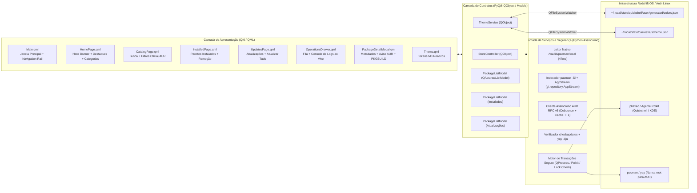

# Arquitetura e Contratos Técnicos — Redshift Store

**Orquestrador e Arquiteto Principal**: Gemini 4 Argon (High)  
**Status**: Marco 1 — Fundação (Aprovado pelo Orquestrador)

---

## 1. Visão Arquitetural

A **Redshift Store** é a loja gráfica nativa de aplicativos do **Redshift OS**, projetada com usabilidade inspirada na Microsoft Store e identidade visual **Material 3 Expressive** 100% sincronizada com o wallpaper e com os modos **end-4 (`illogical-impulse`)** e **Caelestia Shell**.



---

## 2. Estrutura de Diretórios no Repositório

Para integração limpa com o instalador `./setup` (que já gerencia `$XDG_DATA_HOME/redshift-os` e `$XDG_BIN_HOME`), os artefatos da Redshift Store seguem a seguinte organização:

```text
dots/
├── .local/
│   ├── bin/
│   │   └── redshift-store                                # Launcher CLI / Desktop executável
│   └── share/
│       ├── applications/
│       │   └── redshift-store.desktop                    # Entrada XDG Desktop (Redshift Store)
│       └── redshift-os/
│           └── redshift-store/
│               ├── main.py                               # Ponto de entrada PyQt6 + QQmlApplicationEngine
│               ├── backend/
│               │   ├── __init__.py
│               │   ├── models.py                         # Dataclass PackageItem + QAbstractListModel
│               │   ├── security.py                       # Validação de nomes, lock check, pacotes protegidos
│               │   ├── catalog_service.py                # Indexação pacman, AppStream e AUR RPC v5
│               │   ├── transaction_service.py            # Execução assíncrona (QProcess), fila e logs
│               │   ├── theme_service.py                  # Monitoramento Matugen (colors.json / scheme.json)
│               │   └── store_controller.py               # Facade QObject exposta ao QML
│               └── qml/
│                   ├── Main.qml                          # Janela principal e roteamento de páginas
│                   ├── theme/
│                   │   └── Theme.qml                     # Tokens Material 3 Expressive + curvas de animação
│                   ├── components/
│                   │   ├── NavigationSidebar.qml         # Barra lateral estilo Microsoft Store / M3 Rail
│                   │   ├── TopSearchBar.qml              # Busca com debounce, filtros e status de lock
│                   │   ├── PackageCard.qml               # Card responsivo de aplicativo
│                   │   ├── HeroBanner.qml                # Banner em destaque da página inicial
│                   │   ├── CategoryChipBar.qml           # Barra de filtros de categorias e origem
│                   │   ├── PackageDetailDialog.qml       # Modal de detalhes, dependências e PKGBUILD AUR
│                   │   └── OperationsLogDrawer.qml       # Painel de progresso e console de logs em tempo real
│                   └── pages/
│                       ├── HomePage.qml                  # Destaques, recomendados e categorias
│                       ├── CatalogPage.qml               # Resultados de busca e exploração
│                       ├── InstalledPage.qml             # Biblioteca de pacotes instalados
│                       └── UpdatesPage.qml               # Central de atualizações pendentes
sdata/
└── dist-arch/
    └── illogical-impulse-redshift-store/
        └── PKGBUILD                                      # Metapacote de dependências da Redshift Store
tests/
└── test_redshift_store.py                                # Suíte automatizada (unitários, contratos, segurança e UI headless)
```

---

## 3. Contratos de Dados e Interfaces (`QObject` ↔ `QML`)

### 3.1. Contrato de Pacote (`PackageItem` & `PackageListModel`)

Todo item de pacote manipulado pelo backend e exposto pelos modelos `QAbstractListModel` deve respeitar o schema abaixo:

| Campo Python | Role QML (`Qt.UserRole + N`) | Tipo | Descrição |
| :--- | :--- | :--- | :--- |
| `name` | `name` | `str` | Nome exato do pacote (`pkgname`, ex.: `firefox`). |
| `display_name` | `displayName` | `str` | Nome amigável (AppStream ou `pkgname` humanizado). |
| `summary` | `summary` | `str` | Resumo curto do pacote. |
| `description` | `description` | `str` | Descrição detalhada (AppStream ou metadados expandidos). |
| `version` | `version` | `str` | Versão disponível no repositório/AUR. |
| `installed_version` | `installedVersion` | `str` | Versão instalada localmente (`""` se não instalado). |
| `repository` | `repository` | `str` | Repositório de origem (`core`, `extra`, `multilib`, `aur`, `local`). |
| `source` | `source` | `str` | `"official"` ou `"aur"`. |
| `installed` | `installed` | `bool` | `True` se instalado no sistema. |
| `explicit` | `explicit` | `bool` | `True` se instalado explicitamente pelo usuário. |
| `update_available` | `updateAvailable` | `bool` | `True` se houver atualização pendente. |
| `category` | `category` | `str` | Categoria canônica (`featured`, `development`, `games`, `multimedia`, `internet`, `utilities`, `system`, `office`). |
| `icon_name` | `iconName` | `str` | Nome do ícone XDG/AppStream ou glyph Material Symbols. |
| `installed_size` | `installedSize` | `str` | Tamanho instalado formatado (ex.: `"245.8 MiB"`). |
| `download_size` | `downloadSize` | `str` | Tamanho de download formatado. |
| `license` | `license` | `str` | Licenças do pacote. |
| `url` | `url` | `str` | URL upstream do projeto. |
| `depends` | `depends` | `list[str]` | Lista de dependências diretas. |
| `optdepends` | `optdepends` | `list[str]` | Lista de dependências opcionais. |
| `votes` | `votes` | `int` | Número de votos no AUR (`0` para pacotes oficiais). |
| `popularity` | `popularity` | `float` | Popularidade no AUR (`0.0` para pacotes oficiais). |
| `maintainer` | `maintainer` | `str` | Mantenedor ou empacotador. |
| `is_protected` | `isProtected` | `bool` | `True` se for pacote crítico do sistema bloqueado contra remoção. |

### 3.2. Contrato do `StoreController` (Context Property `StoreBridge`)

Registrado no contexto QML como `StoreBridge`:

#### Propriedades (`pyqtProperty`)
- `catalogModel` (`QObject`, constante): instância de `PackageListModel` para resultados de busca/exploração.
- `featuredModel` (`QObject`, constante): instância de `PackageListModel` para destaques da Home.
- `installedModel` (`QObject`, constante): instância de `PackageListModel` para pacotes instalados.
- `updatesModel` (`QObject`, constante): instância de `PackageListModel` para atualizações pendentes.
- `selectedPackage` (`QVariantMap`, notify=`selectedPackageChanged`): dicionário completo do pacote selecionado para a view de detalhes.
- `operationState` (`str`, notify=`operationStateChanged`): `"idle"` | `"searching"` | `"checking_updates"` | `"authenticating"` | `"installing"` | `"removing"` | `"updating"` | `"success"` | `"error"` | `"cancelled"`.
- `operationStatusText` (`str`, notify=`operationStateChanged`): mensagem legível da operação atual.
- `operationProgress` (`int`, notify=`operationProgressChanged`): `0` a `100` (`-1` para indeterminado).
- `isBusy` (`bool`, notify=`operationStateChanged`): `True` quando uma transação de pacote está ativa.
- `isDbLocked` (`bool`, notify=`lockStatusChanged`): `True` se `/var/lib/pacman/db.lck` existir.
- `installedCount` (`int`, notify=`installedChanged`): total de pacotes instalados.
- `updatesCount` (`int`, notify=`updatesChanged`): total de atualizações pendentes.
- `logText` (`str`, notify=`logsChanged`): buffer consolidado de logs da operação atual.
- `activeCategory` (`str`, notify=`filterChanged`): filtro de categoria atual.
- `activeSourceFilter` (`str`, notify=`filterChanged`): `"all"` | `"official"` | `"aur"`.
- `searchQuery` (`str`, notify=`filterChanged`): termo de busca atual.
- `pkgbuildPreview` (`str`, notify=`pkgbuildPreviewChanged`): conteúdo do `PKGBUILD` obtido de forma somente-leitura para revisão de pacotes AUR.

#### Slots (`@pyqtSlot`)
- `search(query: str, source_filter: str, category_filter: str) -> None`
- `setCategory(category: str) -> None`
- `setSourceFilter(source_filter: str) -> None`
- `selectPackage(pkg_name: str, repository: str) -> None`
- `refreshCatalog() -> None`
- `refreshInstalled(explicit_only: bool) -> None`
- `checkUpdates() -> None`
- `installPackage(pkg_name: str, repository: str) -> None`
- `removePackage(pkg_name: str) -> None`
- `updatePackage(pkg_name: str, repository: str) -> None`
- `updateAll() -> None`
- `cancelCurrentOperation() -> None`
- `clearLogs() -> None`
- `fetchPkgbuildPreview(pkg_name: str) -> None`

#### Sinais (`pyqtSignal`)
- `catalogChanged()`
- `installedChanged()`
- `updatesChanged()`
- `selectedPackageChanged()`
- `operationStateChanged()`
- `operationProgressChanged()`
- `logsChanged()`
- `logLineReceived(str)`
- `lockStatusChanged()`
- `filterChanged()`
- `pkgbuildPreviewChanged()`
- `toastMessage(str, str)` — `(level: "info"|"success"|"warning"|"error", message: str)`

### 3.3. Contrato do `ThemeService` (Context Property `ThemeBridge`)

Registrado no contexto QML como `ThemeBridge`:

#### Propriedades (`pyqtProperty`)
- `colors` (`QVariantMap`, notify=`themeChanged`): dicionário contendo os 49 tokens M3 de `~/.local/state/quickshell/user/generated/colors.json` (tanto em `snake_case` quanto em `camelCase`) + tokens semânticos estendidos (`success`, `on_success`, `success_container`, `on_success_container`, `warning`, `on_warning`).
- `isDark` (`bool`, notify=`themeChanged`): `True` para tema escuro, `False` para tema claro.
- `schemeVariant` (`str`, notify=`themeChanged`): variante ativa do Matugen (ex.: `scheme-tonal-spot`, `scheme-fidelity`).
- `wallpaperPath` (`str`, notify=`themeChanged`): caminho do wallpaper atual.
- `frontendMode` (`str`, notify=`themeChanged`): `"end4"` ou `"caelestia"` (lido de `~/.local/state/quickshell/ui-switch/current`).

#### Slots (`@pyqtSlot`)
- `reloadTheme() -> None`
- `toggleColorScheme() -> None` (aciona `switchwall.sh --noswitch --mode dark|light` de forma segura se solicitado pelo usuário, ou alterna preview local em sandbox).

---

## 4. Arquitetura de Segurança (Revisão Obrigatória do Argon)

1. **Sanitização Estrita de Entrada (`backend/security.py`)**:
   - Todo `pkg_name` recebido da UI passa por validação estrita:
     - Regex obrigatória: `^[a-zA-Z0-9][a-zA-Z0-9@._+-]{0,127}$` (proíbe iniciar com `-` para impedir injeção de flags em `pacman`/`yay`, e proíbe metacaracteres de shell).
   - Toda invocação de processo externo utiliza `QProcess` / `subprocess` com lista explícita de argumentos (`argv` array, `shell=False` sempre) e separador `--` antes de nomes de pacotes.
2. **Proteção de Pacotes Críticos (`PROTECTED_PACKAGES`)**:
   - Pacotes essenciais (`base`, `linux`, `linux-lts`, `linux-zen`, `systemd`, `glibc`, `pacman`, `yay`, `sudo`, `polkit`, `hyprland`, `quickshell`, `illogical-impulse-quickshell-git`, `python`, `python-pyqt6`, `qt6-base`, `qt6-declarative`) possuem `is_protected = True` e são bloqueados no backend contra `removePackage`.
3. **Integridade do Banco do Pacman (`db.lck`)**:
   - Antes de qualquer operação de instalação, atualização ou remoção, `security.is_pacman_locked()` verifica `/var/lib/pacman/db.lck`. Se existir, a transação é recusada com aviso claro ao usuário (jamais removendo `db.lck` automaticamente sem confirmação explícita).
4. **Modelo de Privilégios (`pkexec` vs `yay`)**:
   - **Nunca executar `yay` ou `makepkg` como `root`**. Se `os.geteuid() == 0`, o executor de AUR aborta imediatamente com erro de segurança.
   - **Operações Oficiais (`pacman`)**: Executadas via `/usr/bin/pkexec /usr/bin/pacman ... -- <pkg>`, delegando a autenticação ao agente Polkit gráfico da sessão Hyprland (`Quickshell.Services.Polkit` ou `polkit-kde-agent`). Nenhuma senha é lida, solicitada pela loja ou armazenada em memória/disco.
   - **Operações do AUR (`yay`)**: Como `makepkg` proíbe execução como `root` e pode requerer confirmação de `PKGBUILD`/credenciais `sudo` em TTY ou via `pkexec`, o backend:
     - Permite visualizar o `PKGBUILD` diretamente na interface antes de instalar (`fetchPkgbuildPreview`).
     - Executa `yay -S --needed --sudo /usr/bin/pkexec -- <pkg>` (quando não interativo/suportado) ou abre uma sessão controlada visível com logs transmitidos em tempo real, nunca suprimindo verificações de integridade PGP/sha256.
5. **Isolamento de Testes (`REDSHIFT_STORE_SANDBOX=1` / `REDSHIFT_STORE_MOCK=1`)**:
   - Quando a variável de ambiente `REDSHIFT_STORE_MOCK=1` está ativa (ou em testes automatizados), `TransactionService` e `CatalogService` operam sobre fixtures e simuladores em memória/diretório temporário, garantindo risco zero de alterações reais no sistema hospedeiro durante testes.
