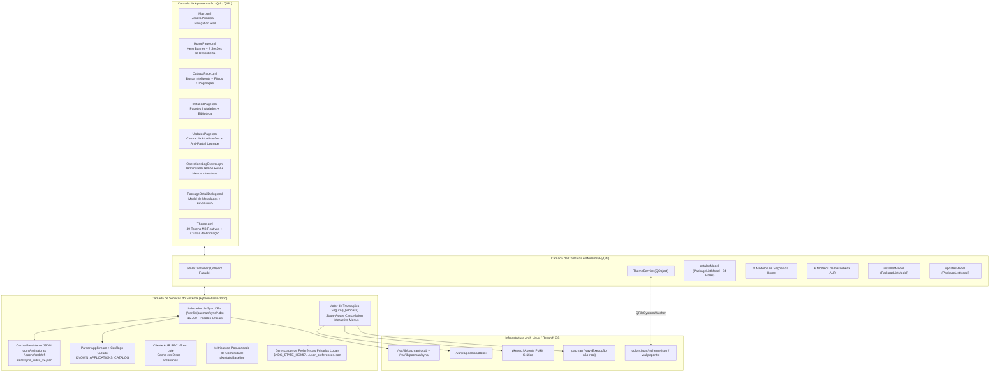
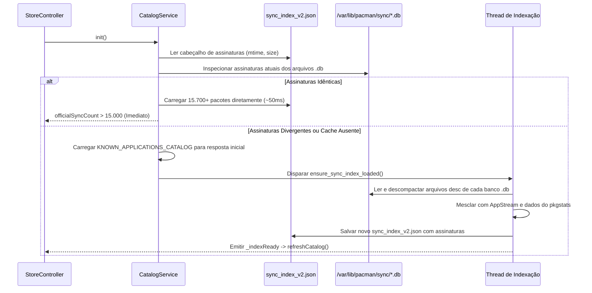
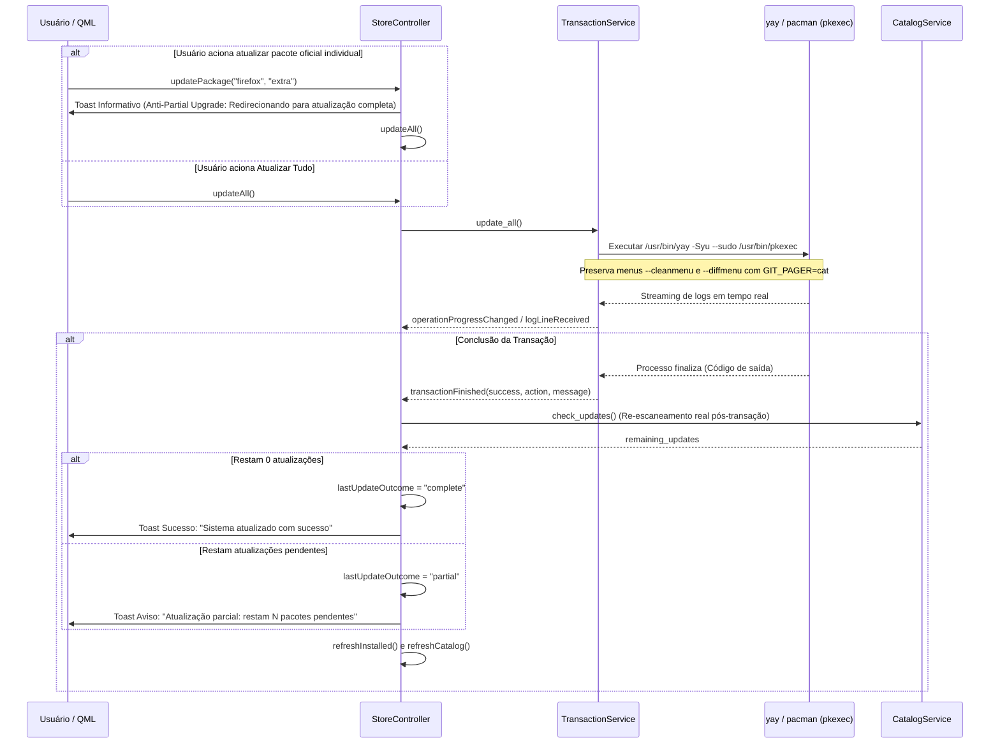

# Arquitetura e Contratos Técnicos — Redshift Store 2.0

**Orquestrador e Arquiteto Principal**: Gemini 4 Argon (High)  
**Engenheiros de Execução**: Backend Transactions, Backend Catalog, Qt6/QML UI, Material You Integration, Quality & Installer  
**Status**: Fase 3A — Validação de Qualidade e Integração Aprovada  

---

## 1. Visão Arquitetural

A **Redshift Store 2.0 (Smart Catalog & Safe Arch Linux)** é a central gráfica de gerenciamento e descoberta de software do **Redshift OS**. Projetada com usabilidade inspirada na Microsoft Store e identidade visual **Material 3 Expressive**, a aplicação integra-se nativamente com os temas do **end-4 (`illogical-impulse`)** e **Caelestia Shell**, operando sobre os repositórios oficiais do Arch Linux e o AUR com garantias rígidas de segurança, integridade e privacidade.



---

## 2. Contratos de Dados e Modelos (`PackageListModel`)

### 2.1 Schema Completo dos 34 Roles

O `PackageListModel` estende `QAbstractListModel` e mapeia 34 roles de dados diretamente consumíveis pelo mecanismo QML:

| # | Role QML (`Qt.UserRole + N`) | Tipo | Descrição e Origem |
| :---: | :--- | :--- | :--- |
| 1 | `name` | `str` | Nome exato do pacote no banco ALPM / AUR (ex.: `firefox`, `blender`). |
| 2 | `displayName` | `str` | Nome amigável de exibição obtido via AppStream ou catálogo enriquecido. |
| 3 | `summary` | `str` | Resumo conciso da finalidade do pacote. |
| 4 | `description` | `str` | Descrição técnica completa do aplicativo ou pacote. |
| 5 | `version` | `str` | Versão disponível para instalação ou atualização nos repositórios. |
| 6 | `installedVersion` | `str` | Versão instalada localmente no sistema (`""` caso não instalado). |
| 7 | `repository` | `str` | Repositório de origem (`core`, `extra`, `multilib`, `aur`). |
| 8 | `source` | `str` | Origem padronizada: `"official"` ou `"aur"`. |
| 9 | `installed` | `bool` | `True` se o pacote consta instalado em `/var/lib/pacman/local/`. |
| 10 | `explicit` | `bool` | `True` se instalado explicitamente pelo usuário (não como dependência). |
| 11 | `updateAvailable` | `bool` | `True` se houver versão mais recente disponível para atualização. |
| 12 | `category` | `str` | Categoria canônica (`internet`, `development`, `games`, `multimedia`, `design`, `utilities`, `system`, `office`). |
| 13 | `iconName` | `str` | Nome do ícone XDG, caminho de imagem ou identificador do Material Symbols. |
| 14 | `installedSize` | `str` | Tamanho descompactado no disco após instalação (ex.: `"197.57 MiB"`). |
| 15 | `downloadSize` | `str` | Tamanho do pacote compactado para download (ex.: `"70.37 MiB"`). |
| 16 | `license` | `str` | Licença de distribuição do software (ex.: `GPL3`, `MIT`). |
| 17 | `url` | `str` | URL da página oficial ou repositório upstream do projeto. |
| 18 | `depends` | `list[str]` | Lista de dependências diretas exigidas pelo pacote. |
| 19 | `optdepends` | `list[str]` | Lista de dependências opcionais sugeridas para funcionalidades extras. |
| 20 | `votes` | `int` | Votos reais recebidos na comunidade do AUR (`0` para oficiais). |
| 21 | `popularity` | `float` | Pontuação de popularidade computada pelo AUR RPC (`0.0` para oficiais). |
| 22 | `maintainer` | `str` | Mantenedor do pacote no repositório oficial ou no AUR. |
| 23 | `isProtected` | `bool` | `True` se for pacote protegido do sistema bloqueado contra remoção. |
| 24 | `itemData` | `dict` | Dicionário consolidado para acesso facilitado a todos os atributos. |
| 25 | `isApplication` | `bool` | `True` se for aplicativo gráfico interativo com entrada no desktop. |
| 26 | `appId` | `str` | Identificador AppStream XDG (ex.: `org.kde.krita.desktop`). |
| 27 | `screenshots` | `list[str]` | URLs de capturas de tela registradas nos metadados AppStream. |
| 28 | `popularitySource` | `str` | Fonte da métrica: `"pkgstats"` (oficiais), `"aur_rpc"` (AUR) ou `"catalog"`. |
| 29 | `popularityLabel` | `str` | Rótulo formatado legível (ex.: `"69.1% dos usuários Arch"`, `"1.240 votos"`). |
| 30 | `provenance` | `str` | Canal de procedência: `"repo"`, `"aur"`, `"curated"`, `"personalized"`. |
| 31 | `provenanceLabel` | `str` | Justificativa ou procedência legível exibida no cartão do aplicativo. |
| 32 | `isFavorite` | `bool` | `True` se o usuário marcou o pacote como favorito local. |
| 33 | `buildDate` | `int` | Timestamp Unix da data de compilação do pacote. |
| 34 | `groups` | `list[str]` | Grupos de pacotes do pacman aos quais o software pertence. |

### 2.2 Métodos do `PackageListModel`
- `rowCount() -> int` / `count -> int`: Retorna o total de elementos no modelo.
- `set_items(items: Sequence[PackageItem]) -> None`: Substituição atômica de todos os itens com emissão de `beginResetModel`/`endResetModel`.
- `append_items(items: Sequence[PackageItem]) -> None`: Inserção incremental eficiente com prevenção automática de duplicatas por índice de nomes (`_name_index`).
- `get_by_name(name: str) -> PackageItem | None`: Consulta por nome com complexidade $O(1)$.
- `get_dict_by_name(name: str) -> dict[str, Any]`: Consulta retornando dicionário serializado para consumo QML.
- `get_at(row: int) -> PackageItem | None`: Acesso posicional por índice.
- `clear() -> None`: Limpeza total do modelo.

---

## 3. Contrato da Fachada `StoreController` (`StoreBridge`)

A classe `StoreController` atua como a fachada central exposta ao contexto raiz do QML sob a propriedade `StoreBridge`.

### 3.1 Modelos Expostos

```text
StoreController
├── catalogModel                # Modelo da grade de busca e catálogo geral (paginado)
├── featuredModel               # Banner principal de destaques curados da Home
├── installedModel              # Biblioteca de aplicativos e pacotes instalados
├── updatesModel                # Central de atualizações pendentes (oficiais e AUR)
│
├── Seções da Página Início (Home):
│   ├── recommendedModel        # Recomendações personalizadas locais transparentes
│   ├── popularCommunityModel   # Populares da comunidade Arch (pkgstats)
│   ├── gettingStartedModel     # Primeiros passos essenciais no Redshift OS
│   ├── developmentSectionModel # Ambiente de desenvolvimento e ferramentas
│   ├── gamesSectionModel       # Jogos nativos, emuladores e launchers
│   ├── designSectionModel      # Design gráfico, 3D e edição multimídia
│   └── communicationSectionModel # Mensageiros, navegadores e comunicação
│
└── Seções de Descoberta do AUR:
    ├── aurPopularModel         # Mais votados da comunidade AUR
    ├── aurCommunityModel       # Destaques comunitários gerais
    ├── aurDevModel             # Ferramentas de desenvolvimento no AUR
    ├── aurGamesModel           # Jogos e utilitários de jogos no AUR
    ├── aurProductivityModel    # Aplicativos de escritório e produtividade no AUR
    └── aurCuratedModel         # Curadoria de pacotes estáveis recomendados do AUR
```

### 3.2 Propriedades Reativas (`pyqtProperty`)

| Propriedade | Tipo | Sinal de Notificação | Descrição |
| :--- | :--- | :--- | :--- |
| `officialSyncCount` | `int` | `catalogChanged` | Total de pacotes indexados dos repositórios oficiais (`> 15.000`). |
| `personalizationEnabled` | `bool` | `personalizationChanged` | Estado de ativação das recomendações personalizadas locais. |
| `hasPersonalizationHistory` | `bool` | `personalizationChanged` | Indica se há histórico ou favoritos locais registrados no disco. |
| `favoritesCount` | `int` | `personalizationChanged` | Quantidade total de pacotes favoritados pelo usuário. |
| `lastUpdateOutcome` | `str` | `updatesChanged` | Resultado pós-verificado: `""`, `"complete"`, `"partial"`, `"cancelled"`, `"failed"`. |
| `lastUpdateSummary` | `str` | `updatesChanged` | Resumo detalhado do desfecho da última operação de atualização. |
| `canLoadMoreCatalog` | `bool` | `catalogChanged` | `True` se houver páginas adicionais a serem carregadas na busca. |
| `catalogStatus` | `str` | `catalogChanged` | Estado da pesquisa: `"ready"`, `"loading"`, `"no_results"`, `"network_error"`. |
| `catalogStatusMessage` | `str` | `catalogChanged` | Mensagem descritiva associada ao status do catálogo. |
| `catalogTotalCount` | `int` | `catalogChanged` | Contagem total de correspondências encontradas no universo filtrado. |
| `activeCategory` | `str` | `filterChanged` | Categoria canônica ativa na filtragem. |
| `activeSourceFilter` | `str` | `filterChanged` | Filtro de origem ativo: `"all"`, `"official"`, `"aur"`. |
| `activeInstalledFilter` | `str` | `filterChanged` | Filtro de instalação: `"all"`, `"installed"`, `"not_installed"`. |
| `activeSortBy` | `str` | `filterChanged` | Critério de ordenação: `"relevance"`, `"popularity"`, `"name"`, `"recent"`. |
| `includeSystemPackages` | `bool` | `filterChanged` | Alterna inclusão de bibliotecas e pacotes de baixo nível. |
| `isIndexingCatalog` | `bool` | `catalogChanged` | `True` enquanto a indexação em segundo plano estiver em execução. |
| `selectedPackage` | `QVariantMap` | `selectedPackageChanged` | Dados consolidados do pacote selecionado para visualização em detalhes. |
| `pkgbuildPreview` | `str` | `pkgbuildPreviewChanged` | Conteúdo do PKGBUILD obtido para inspeção de pacotes AUR. |
| `operationState` | `str` | `operationStateChanged` | Estado da operação: `"idle"`, `"installing"`, `"removing"`, `"updating"`, etc. |
| `transactionStage` | `str` | `operationStateChanged` | Estágio atual da transação: `"downloading"`, `"compiling"`, `"committing"`. |
| `canCancel` | `bool` | `operationStateChanged` | `True` se o cancelamento for seguro no estágio em execução. |
| `waitingForInput` | `bool` | `promptChanged` | `True` se o gerenciador de pacotes estiver aguardando resposta interativa. |
| `currentPromptText` | `str` | `promptChanged` | Texto do prompt interativo capturado do terminal. |
| `isBusy` | `bool` | `operationStateChanged` | `True` se houver transação em execução. |
| `isDbLocked` | `bool` | `lockStatusChanged` | `True` se `/var/lib/pacman/db.lck` estiver presente no sistema. |
| `installedCount` | `int` | `installedChanged` | Total de pacotes instalados no sistema. |
| `updatesCount` | `int` | `updatesChanged` | Total de atualizações pendentes disponíveis. |
| `logText` | `str` | `logsChanged` | Buffer consolidado de logs transmitidos pelo terminal. |

### 3.3 Slots Públicos (`@pyqtSlot`)

```python
# Busca, Filtros e Paginação
search(query: str, source_filter: str = "all", category_filter: str = "all") -> None
setCategory(category: str) -> None
setSourceFilter(source_filter: str) -> None
setInstalledFilter(installed_filter: str) -> None
setSortBy(sort_by: str) -> None
setIncludeSystemPackages(include_sys: bool) -> None
loadMoreCatalog() -> None
exploreSection(section_id: str) -> None

# Detalhes, Favoritos e Personalização
selectPackage(pkg_name: str, repository: str = "") -> None
toggleFavorite(pkg_name: str) -> None
setPersonalizationEnabled(enabled: bool) -> None
clearPersonalizationHistory() -> None
fetchPkgbuildPreview(pkg_name: str) -> None
hasDesktopIcon(icon_name: str) -> bool

# Atualizações e Transações
refreshCatalog() -> None
refreshHomeSections() -> None
refreshAurDiscovery() -> None
refreshInstalled(explicit_only: bool = False) -> None
checkUpdates() -> None
installPackage(pkg_name: str, repository: str = "official") -> None
removePackage(pkg_name: str) -> None
updatePackage(pkg_name: str, repository: str = "official") -> None
updateAll() -> None
cancelCurrentOperation() -> None
respondToPrompt(accept: bool) -> bool
sendTransactionInput(text: str) -> bool
sendInput(text: str) -> bool
clearLogs() -> None
```

---

## 4. Arquitetura de Indexação Assíncrona

A indexação de pacotes opera com máxima eficiência em duas camadas:



---

## 5. Fluxo de Transações e Pós-Verificação Real

O fluxo de atualização foi especialmente arquitetado para mitigar os riscos de inconsistência binária (*partial upgrades*) característicos do Arch Linux:



---

## 6. Governança de Privacidade e Segurança

1. **Privacidade Absoluta**: Nenhuma informação de telemetria, pesquisa, visualização de pacote ou categorias visitadas é enviada para qualquer servidor externo. O arquivo de preferências reside unicamente no disco local em `$XDG_STATE_HOME/redshift-store/user_preferences.json`.
2. **Proteção do Sistema**: Pacotes essenciais (`PROTECTED_PACKAGES`) são terminantemente bloqueados contra remoção. Nomes de pacotes são rigorosamente validados contra injeção de parâmetros antes de qualquer montagem de comando.
3. **Execução Segura do AUR**: Comandos comunitários jamais são executados sob root (`EUID != 0`). A elevação de privilégios para instalação final de binários compilados é delegada exclusivamente ao Polkit (`/usr/bin/pkexec`).
