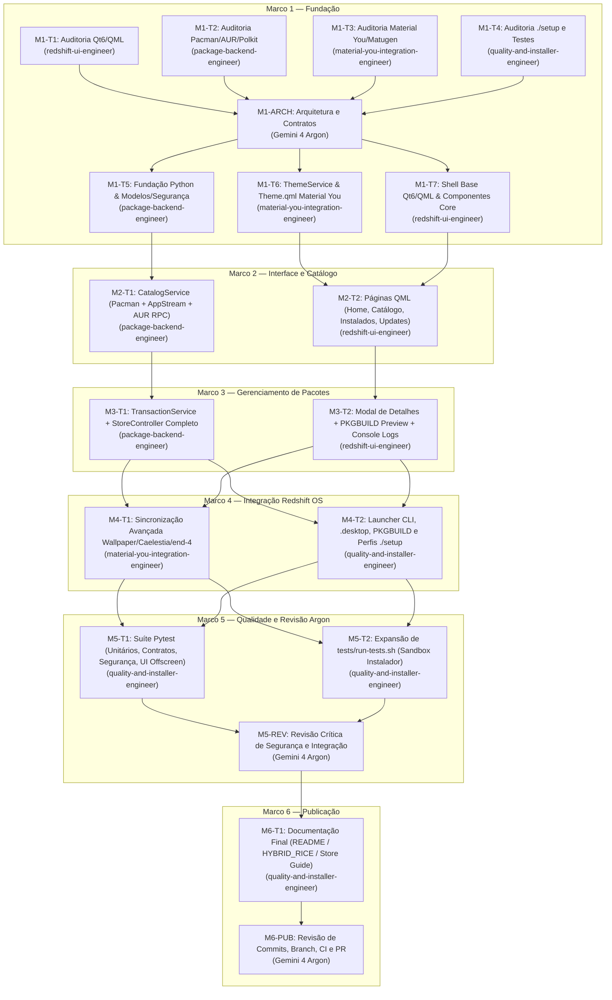

# Plano de Delegação Multiagente e Grafo de Dependências — Redshift Store

**Orquestrador**: Gemini 4 Argon (High)  
**Executores Especializados**: Subagentes Gemini 3.8 Flash (`model: flash` → `gemini-3.8-flash-tiered`)  
**Limite de Paralelismo**: Máximo de 4 subagentes simultâneos (zero sobreposição de arquivos em tarefas concorrentes).

---

## 1. Grafo Global de Dependências (Marcos 1 a 6)

---

## 2. Detalhamento Completo das Tarefas (10 Campos Obrigatórios)

### Marco 1 — Fundação

#### `M1-T1` — Auditoria de Ambiente Qt6/QML e Design System Redshift OS
1. **Identificador único**: `M1-T1`
2. **Descrição objetiva**: Auditar pacotes Qt6/QML/Python-Qt instalados e padrões visuais do Redshift OS.
3. **Agente responsável**: `redshift-ui-engineer`
4. **Arquivos permitidos**: Somente leitura em `dots/.config/quickshell/` e `dots-extra/`.
5. **Dependências**: Nenhuma.
6. **Entradas necessárias**: Repositório local e ambiente Arch Linux.
7. **Resultado esperado**: Relatório técnico de versão do Qt6, binding Python (`PyQt6`) e tokens visuais.
8. **Critérios de aceitação**: Verificação offscreen de `QQmlApplicationEngine` com código de saída 0.
9. **Testes obrigatórios**: Instanciação `QGuiApplication` + `QQmlApplicationEngine` (`QT_QPA_PLATFORM=offscreen`).
10. **Condições de bloqueio**: Proibido alterar arquivos.
- **Status**: **CONCLUÍDA** (Sessão `23311e73-e9d8-46ed-9b04-2fbbab6871a0`).

#### `M1-T2` — Auditoria de Infraestrutura de Pacotes (`pacman`, `yay`, AppStream, Polkit)
1. **Identificador único**: `M1-T2`
2. **Descrição objetiva**: Auditar versões, caches e tempos de resposta de `pacman`, `yay`, `checkupdates`, `AppStream` e `pkexec`.
3. **Agente responsável**: `package-backend-engineer`
4. **Arquivos permitidos**: Somente leitura no sistema e repositório.
5. **Dependências**: Nenhuma.
6. **Entradas necessárias**: Ambiente Arch Linux.
7. **Resultado esperado**: Diagnóstico de performance de leitura local (`/var/lib/pacman/local` em 47ms) e AUR RPC v5.
8. **Critérios de aceitação**: Confirmar caminhos de metadados e agentes Polkit.
9. **Testes obrigatórios**: Benchmark somente-leitura de `/var/lib/pacman/local`, `gi.repository.AppStream` e AUR RPC v5.
10. **Condições de bloqueio**: Proibido executar operações com privilégio.
- **Status**: **CONCLUÍDA** (Sessão `2569ca5d-1186-4af5-bf2f-fbb0d87f5d90`).

#### `M1-T3` — Auditoria da Infraestrutura Material You e Matugen
1. **Identificador único**: `M1-T3`
2. **Descrição objetiva**: Mapear geração de paletas Matugen (`colors.json` e `scheme.json`) nos modos `end-4` e `Caelestia`.
3. **Agente responsável**: `material-you-integration-engineer`
4. **Arquivos permitidos**: Somente leitura em `dots/` e `~/.local/state/`.
5. **Dependências**: Nenhuma.
6. **Entradas necessárias**: Scripts `switchwall.sh`, `end4-theme-bridge.sh` e configurações Matugen.
7. **Resultado esperado**: Mapeamento dos 49 tokens M3 e estratégia de `QFileSystemWatcher`.
8. **Critérios de aceitação**: Confirmar compatibilidade sem modificar geradores globais.
9. **Testes obrigatórios**: Validação via Python dos schemas de `colors.json` e `scheme.json`.
10. **Condições de bloqueio**: Proibido modificar arquivos.
- **Status**: **CONCLUÍDA** (Sessão `8c778f36-5f3c-4185-b36a-7c6b2f26fb5a`).

#### `M1-T4` — Auditoria do Instalador `./setup`, Perfis, PKGBUILDs e Suíte de Testes
1. **Identificador único**: `M1-T4`
2. **Descrição objetiva**: Mapear integração no `./setup`, perfis `minimal`/`hybrid`/`complete` e baseline de testes.
3. **Agente responsável**: `quality-and-installer-engineer`
4. **Arquivos permitidos**: Somente leitura em `setup`, `sdata/` e `tests/`.
5. **Dependências**: Nenhuma.
6. **Entradas necessárias**: Repositório local.
7. **Resultado esperado**: Lista de arquivos de integração do Marco 4 e validação da baseline de 164 testes.
8. **Critérios de aceitação**: 164/164 testes passando em `tests/run-tests.sh`.
9. **Testes obrigatórios**: `bash tests/run-tests.sh`.
10. **Condições de bloqueio**: Proibido modificar arquivos ou rodar instalação real.
- **Status**: **CONCLUÍDA** (Sessão `21d9bb51-8041-49a0-9633-2d397eac226a`).

#### `M1-T5` — Estrutura Base Python, Modelos (`PackageListModel`) e Módulo de Segurança (`security.py`)
1. **Identificador único**: `M1-T5`
2. **Descrição objetiva**: Implementar a fundação do pacote Python da Redshift Store, incluindo o dataclass `PackageItem`, `PackageListModel(QAbstractListModel)` e o módulo de segurança `security.py` (validação regex, verificação de `db.lck`, proteção de pacotes críticos e bloqueio de root para AUR).
3. **Agente responsável**: `package-backend-engineer`
4. **Arquivos permitidos**:
   - `dots/.local/share/redshift-os/redshift-store/backend/__init__.py`
   - `dots/.local/share/redshift-os/redshift-store/backend/models.py`
   - `dots/.local/share/redshift-os/redshift-store/backend/security.py`
5. **Dependências**: `M1-ARCH` (`docs/REDSHIFT_STORE_ARCHITECTURE.md`).
6. **Entradas necessárias**: Especificação de contratos na Seção 3.1 e Seção 4 de `docs/REDSHIFT_STORE_ARCHITECTURE.md`.
7. **Resultado esperado**: Modelos Qt6 e validadores de segurança prontos e testados.
8. **Critérios de aceitação**: Todas as 21 roles do `PackageListModel` expostas ao QML; `validate_package_name` rejeitando flags (`--help`, `-S`), espaços e metacaracteres (`;`, `|`, `&`, `$`); `is_protected_package` protegendo pacotes vitais.
9. **Testes obrigatórios**: Teste via `python3 -c` validando instanciação do `PackageListModel`, leitura de roles e asserções de segurança.
10. **Condições de bloqueio**: Não tocar em arquivos QML ou de outros agentes.

#### `M1-T6` — `ThemeService` Python e Singleton `Theme.qml` (Material You / Matugen)
1. **Identificador único**: `M1-T6`
2. **Descrição objetiva**: Implementar o serviço `ThemeService(QObject)` que monitora `~/.local/state/quickshell/user/generated/colors.json` e `~/.local/state/caelestia/scheme.json` via `QFileSystemWatcher` (com debounce e reanexação pós-escrita atômica) e o componente `Theme.qml` com os tokens Material 3 Expressive, tipografia e curvas de animação do Redshift OS.
3. **Agente responsável**: `material-you-integration-engineer`
4. **Arquivos permitidos**:
   - `dots/.local/share/redshift-os/redshift-store/backend/theme_service.py`
   - `dots/.local/share/redshift-os/redshift-store/qml/theme/Theme.qml`
5. **Dependências**: `M1-ARCH` (`docs/REDSHIFT_STORE_ARCHITECTURE.md`).
6. **Entradas necessárias**: Contratos da Seção 3.3 de `docs/REDSHIFT_STORE_ARCHITECTURE.md` e auditoria `M1-T3`.
7. **Resultado esperado**: Sincronização reativa de cores M3, detecção automática de tema claro/escuro e modo (`end4`/`caelestia`), com fallback seguro.
8. **Critérios de aceitação**: Carregar os 49 tokens M3 reais de `colors.json` quando presente e cair em fallback dark M3 válido quando ausente; `Theme.qml` carregável sem erros no `QQmlApplicationEngine`.
9. **Testes obrigatórios**: Teste headless (`QT_QPA_PLATFORM=offscreen`) carregando `ThemeService` + `Theme.qml` e verificando tokens primários e reação a atualização de arquivo temporário.
10. **Condições de bloqueio**: Não modificar `switchwall.sh` nem `~/.config/matugen/config.toml`.

#### `M1-T7` — Estrutura Base Qt6/QML (`NavigationSidebar.qml`, `TopSearchBar.qml`, `PackageCard.qml`, `HeroBanner.qml`, `CategoryChipBar.qml`)
1. **Identificador único**: `M1-T7`
2. **Descrição objetiva**: Implementar os componentes visuais reutilizáveis do Design System Redshift OS para a Redshift Store (barra de navegação lateral estilo Microsoft Store/M3 Rail, barra superior de busca com debounce e filtros, card responsivo de aplicativo, hero banner e barra de chips de categorias).
3. **Agente responsável**: `redshift-ui-engineer`
4. **Arquivos permitidos**:
   - `dots/.local/share/redshift-os/redshift-store/qml/components/NavigationSidebar.qml`
   - `dots/.local/share/redshift-os/redshift-store/qml/components/TopSearchBar.qml`
   - `dots/.local/share/redshift-os/redshift-store/qml/components/PackageCard.qml`
   - `dots/.local/share/redshift-os/redshift-store/qml/components/HeroBanner.qml`
   - `dots/.local/share/redshift-os/redshift-store/qml/components/CategoryChipBar.qml`
5. **Dependências**: `M1-ARCH` (`docs/REDSHIFT_STORE_ARCHITECTURE.md`).
6. **Entradas necessárias**: Contratos da Seção 3 de `docs/REDSHIFT_STORE_ARCHITECTURE.md` e tokens de `Theme.qml`.
7. **Resultado esperado**: Componentes QML modulares, responsivos, animados e livres de erros de sintaxe.
8. **Critérios de aceitação**: Todos os 5 componentes compilam e instanciam em modo `QT_QPA_PLATFORM=offscreen`.
9. **Testes obrigatórios**: Validação individual de carregamento QML em modo offscreen.
10. **Condições de bloqueio**: Não modificar arquivos Python do backend.

---

### Marco 2 — Interface e Catálogo

#### `M2-T1` — `CatalogService` (Indexação Pacman Local/Sync, AppStream e Cliente AUR RPC v5)
1. **Identificador único**: `M2-T1`
2. **Descrição objetiva**: Implementar `catalog_service.py` com leitura ultrarrápida de `/var/lib/pacman/local`, indexação de repositórios oficiais (`pacman -Sl`), enriquecimento de metadados/ícones/categorias via `gi.repository.AppStream` e `.desktop` locais, curadoria de pacotes em destaque do Redshift OS, verificação de atualizações (`checkupdates` + `yay -Qu`) e cliente assíncrono `AUR RPC v5` com cache TTL e modo mock/sandbox.
3. **Agente responsável**: `package-backend-engineer`
4. **Arquivos permitidos**:
   - `dots/.local/share/redshift-os/redshift-store/backend/catalog_service.py`
5. **Dependências**: `M1-T5`.
6. **Entradas necessárias**: `models.py` e `security.py`.
7. **Resultado esperado**: Serviço completo de catálogo e descoberta de pacotes oficiais e AUR.
8. **Critérios de aceitação**: Indexação local em < 600ms; suporte a busca por texto, filtro por origem (`all`, `official`, `aur`) e categoria; suporte a `REDSHIFT_STORE_MOCK=1`.
9. **Testes obrigatórios**: Testes em Python validando busca local, busca mockada, categorização e leitura de `PKGBUILD` preview do AUR.
10. **Condições de bloqueio**: Não executar comandos privilegiados.

#### `M2-T2` — Páginas Principais QML (`HomePage.qml`, `CatalogPage.qml`, `InstalledPage.qml`, `UpdatesPage.qml`)
1. **Identificador único**: `M2-T2`
2. **Descrição objetiva**: Implementar as quatro páginas principais de navegação da Redshift Store com layouts responsivos em grid/lista, estados de carregamento, estados vazios e integração com os modelos `featuredModel`, `catalogModel`, `installedModel` e `updatesModel`.
3. **Agente responsável**: `redshift-ui-engineer`
4. **Arquivos permitidos**:
   - `dots/.local/share/redshift-os/redshift-store/qml/pages/HomePage.qml`
   - `dots/.local/share/redshift-os/redshift-store/qml/pages/CatalogPage.qml`
   - `dots/.local/share/redshift-os/redshift-store/qml/pages/InstalledPage.qml`
   - `dots/.local/share/redshift-os/redshift-store/qml/pages/UpdatesPage.qml`
5. **Dependências**: `M1-T6`, `M1-T7`.
6. **Entradas necessárias**: `Theme.qml`, componentes de `qml/components/` e contrato `StoreBridge`.
7. **Resultado esperado**: Quatro páginas completas e responsivas no estilo Microsoft Store + Material You.
8. **Critérios de aceitação**: Compilação limpa em QML offscreen e vinculação correta às roles do `PackageListModel`.
9. **Testes obrigatórios**: Carregamento QML offscreen de cada página com mock de `StoreBridge` e `ThemeBridge`.
10. **Condições de bloqueio**: Não alterar arquivos Python.

---

### Marco 3 — Gerenciamento de Pacotes

#### `M3-T1` — `TransactionService`, `StoreController` e Ponto de Entrada `main.py`
1. **Identificador único**: `M3-T1`
2. **Descrição objetiva**: Implementar `transaction_service.py` (execução assíncrona via `QProcess` para instalação, remoção e atualização com `pkexec pacman` para pacotes oficiais e fluxo seguro não-root para AUR, streaming de logs em tempo real, detecção de `db.lck` e modo `REDSHIFT_STORE_MOCK=1`), `store_controller.py` (`StoreController` completo unindo `CatalogService` e `TransactionService`) e `main.py`.
3. **Agente responsável**: `package-backend-engineer`
4. **Arquivos permitidos**:
   - `dots/.local/share/redshift-os/redshift-store/backend/transaction_service.py`
   - `dots/.local/share/redshift-os/redshift-store/backend/store_controller.py`
   - `dots/.local/share/redshift-os/redshift-store/main.py`
5. **Dependências**: `M1-T5`, `M1-T6`, `M2-T1`.
6. **Entradas necessárias**: Contratos da Seção 3.2 e regras de segurança da Seção 4 de `docs/REDSHIFT_STORE_ARCHITECTURE.md`.
7. **Resultado esperado**: Backend completo e funcional conectado ao motor QML.
8. **Critérios de aceitação**: Nenhuma operação bloqueia a thread de UI; todas as transações passam por `security.py`; modo `--self-test` / `--dry-run` em `main.py` valida inicialização completa.
9. **Testes obrigatórios**: Simulação de instalação, remoção, atualização e bloqueio de pacotes protegidos com `REDSHIFT_STORE_MOCK=1`.
10. **Condições de bloqueio**: Jamais executar operações destrutivas reais no host durante os testes.

#### `M3-T2` — Janela Principal (`Main.qml`), Modal de Detalhes (`PackageDetailDialog.qml`) e Console de Operações (`OperationsLogDrawer.qml`)
1. **Identificador único**: `M3-T2`
2. **Descrição objetiva**: Implementar `PackageDetailDialog.qml` (com aviso de segurança do AUR, visualizador de `PKGBUILD`, lista de dependências e botões de ação), `OperationsLogDrawer.qml` (barra de progresso, estado da transação, botão cancelar e console de logs em tempo real com fonte `JetBrains Mono NF`) e `Main.qml` integrando toda a aplicação.
3. **Agente responsável**: `redshift-ui-engineer`
4. **Arquivos permitidos**:
   - `dots/.local/share/redshift-os/redshift-store/qml/components/PackageDetailDialog.qml`
   - `dots/.local/share/redshift-os/redshift-store/qml/components/OperationsLogDrawer.qml`
   - `dots/.local/share/redshift-os/redshift-store/qml/Main.qml`
5. **Dependências**: `M2-T2`, `M3-T1`.
6. **Entradas necessárias**: Páginas de `qml/pages/`, componentes de `qml/components/`, `Theme.qml` e contratos `StoreBridge` / `ThemeBridge`.
7. **Resultado esperado**: Interface gráfica completa da Redshift Store pronta para execução.
8. **Critérios de aceitação**: Inicialização completa via `QT_QPA_PLATFORM=offscreen python3 main.py --self-test` sem warnings ou erros QML.
9. **Testes obrigatórios**: Execução headless completa de `main.py --self-test` renderizando e navegando pelas páginas.
10. **Condições de bloqueio**: Não alterar arquivos de backend sem autorização do orquestrador.

---

### Marco 4 — Integração Redshift OS

#### `M4-T1` — Integração de Atalhos/Launchers nos Shells (`end-4` e `Caelestia`) e Verificação de Tema Dinâmico
1. **Identificador único**: `M4-T1`
2. **Descrição objetiva**: Validar e aprimorar a integração visual da Redshift Store com os temas claro/escuro e paletas Matugen nos dois modos do Hyprland (`end-4` e `Caelestia`), incluindo suporte a ícone simbólico/emblema do Redshift OS na janela e reação instantânea a mudanças de paleta.
3. **Agente responsável**: `material-you-integration-engineer`
4. **Arquivos permitidos**:
   - `dots/.local/share/redshift-os/redshift-store/backend/theme_service.py`
   - `dots/.local/share/redshift-os/redshift-store/qml/theme/Theme.qml`
5. **Dependências**: `M3-T1`, `M3-T2`.
6. **Entradas necessárias**: Aplicação integrada do Marco 3.
7. **Resultado esperado**: Transição suave de cores em tempo real ao alterar `colors.json` ou alternar entre modo claro e escuro.
8. **Critérios de aceitação**: Teste automatizado simulando troca de wallpaper/paleta (`scheme-tonal-spot` dark -> `scheme-vibrant` light) com atualização reativa imediata das propriedades de `Theme.qml`.
9. **Testes obrigatórios**: Teste de mutação de `colors.json` e `scheme.json` em diretório temporário validando emissão de `themeChanged`.
10. **Condições de bloqueio**: Não alterar geradores globais sem autorização.

#### `M4-T2` — Launcher `redshift-store`, `.desktop`, `PKGBUILD` e Integração no `./setup` (`minimal`, `hybrid`, `complete`)
1. **Identificador único**: `M4-T2`
2. **Descrição objetiva**: Criar o executável `dots/.local/bin/redshift-store`, o arquivo `dots/.local/share/applications/redshift-store.desktop`, o pacote `sdata/dist-arch/illogical-impulse-redshift-store/PKGBUILD` e integrar a Redshift Store ao instalador `./setup` e aos perfis `minimal.conf`, `hybrid.conf` e `complete.conf` (incluindo `uninstall-deps.sh` e `sdata/profiles/README.md`).
3. **Agente responsável**: `quality-and-installer-engineer`
4. **Arquivos permitidos**:
   - `dots/.local/bin/redshift-store`
   - `dots/.local/share/applications/redshift-store.desktop`
   - `sdata/dist-arch/illogical-impulse-redshift-store/PKGBUILD`
   - `sdata/dist-arch/uninstall-deps.sh`
   - `sdata/profiles/minimal.conf`
   - `sdata/profiles/hybrid.conf`
   - `sdata/profiles/complete.conf`
   - `sdata/profiles/README.md`
   - `dots/.config/hypr/hyprland/keybinds.conf` (atalho opcional seguro `Super+Shift+S` ou launcher se aplicável)
5. **Dependências**: `M3-T1`, `M3-T2`.
6. **Entradas necessárias**: Mapeamento da auditoria `M1-T4` e `docs/REDSHIFT_STORE_ARCHITECTURE.md`.
7. **Resultado esperado**: Redshift Store instalada automaticamente junto com o Redshift OS nos três perfis (`minimal`, `hybrid`, `complete`) e desinstalável de forma limpa.
8. **Critérios de aceitação**: `./setup install --dry-run --profile {minimal,hybrid,complete}` lista `illogical-impulse-redshift-store` e sincroniza `$XDG_BIN_HOME/redshift-store`, `$XDG_DATA_HOME/applications/redshift-store.desktop` e `$XDG_DATA_HOME/redshift-os`.
9. **Testes obrigatórios**: Validação de sintaxe bash (`bash -n`), validação do `PKGBUILD` e dry-run dos 3 perfis.
10. **Condições de bloqueio**: Não executar instalação destrutiva no host.

---

### Marco 5 — Qualidade

#### `M5-T1` — Suíte Automatizada da Redshift Store (`tests/test_redshift_store.py`)
1. **Identificador único**: `M5-T1`
2. **Descrição objetiva**: Implementar suíte abrangente de testes unitários, de integração, de segurança e de interface QML headless em `tests/test_redshift_store.py`.
3. **Agente responsável**: `quality-and-installer-engineer`
4. **Arquivos permitidos**:
   - `tests/test_redshift_store.py`
5. **Dependências**: `M4-T1`, `M4-T2`.
6. **Entradas necessárias**: Todo o código de `dots/.local/share/redshift-os/redshift-store/`.
7. **Resultado esperado**: Cobertura de busca, filtros, parsing real de `/var/lib/pacman/local`, sincronização de cores Material You, bloqueio de injeção de comandos, bloqueio de pacotes protegidos, detecção de `db.lck`, proibição de root no AUR e renderização QML offscreen.
8. **Critérios de aceitação**: 100% dos testes passando em execução isolada (`QT_QPA_PLATFORM=offscreen python3 -m unittest tests/test_redshift_store.py`).
9. **Testes obrigatórios**: Execução completa de `tests/test_redshift_store.py`.
10. **Condições de bloqueio**: Não aprovar sozinho a qualidade final sem revisão do Argon.

#### `M5-T2` — Integração na Suíte Global do Instalador (`tests/run-tests.sh`)
1. **Identificador único**: `M5-T2`
2. **Descrição objetiva**: Adicionar asserções dedicadas em `tests/run-tests.sh` validando o `PKGBUILD` da Redshift Store, presença nos perfis `minimal`, `hybrid` e `complete`, sincronização do launcher/desktop file em sandbox e invocação de `tests/test_redshift_store.py`.
3. **Agente responsável**: `quality-and-installer-engineer`
4. **Arquivos permitidos**:
   - `tests/run-tests.sh`
5. **Dependências**: `M5-T1`.
6. **Entradas necessárias**: `tests/run-tests.sh` e `tests/test_redshift_store.py`.
7. **Resultado esperado**: Suíte global `tests/run-tests.sh` validando tanto o Redshift OS quanto a Redshift Store em sandbox.
8. **Critérios de aceitação**: `bash tests/run-tests.sh` com 0 falhas.
9. **Testes obrigatórios**: `bash tests/run-tests.sh`.
10. **Condições de bloqueio**: Preservar todas as 164 asserções existentes sem regressão.

---

### Marco 6 — Publicação

#### `M6-T1` — Documentação da Redshift Store e Atualização do Guia do Repositório
1. **Identificador único**: `M6-T1`
2. **Descrição objetiva**: Criar a documentação dedicada `docs/REDSHIFT_STORE.md` e atualizar `README.md` e `HYBRID_RICE.md` documentando a Redshift Store e a arquitetura multiagente.
3. **Agente responsável**: `quality-and-installer-engineer`
4. **Arquivos permitidos**:
   - `docs/REDSHIFT_STORE.md`
   - `README.md`
   - `HYBRID_RICE.md`
5. **Dependências**: Revisão `M5-REV` aprovada pelo Argon.
6. **Entradas necessárias**: Implementação validada dos Marcos 1 a 5.
7. **Resultado esperado**: Documentação completa de arquitetura, uso, segurança e manutenção da Redshift Store.
8. **Critérios de aceitação**: Links válidos, instruções precisas e conformidade com os testes de documentação de `tests/run-tests.sh`.
9. **Testes obrigatórios**: `bash tests/run-tests.sh`.
10. **Condições de bloqueio**: Não alterar código-fonte durante a tarefa de documentação.
